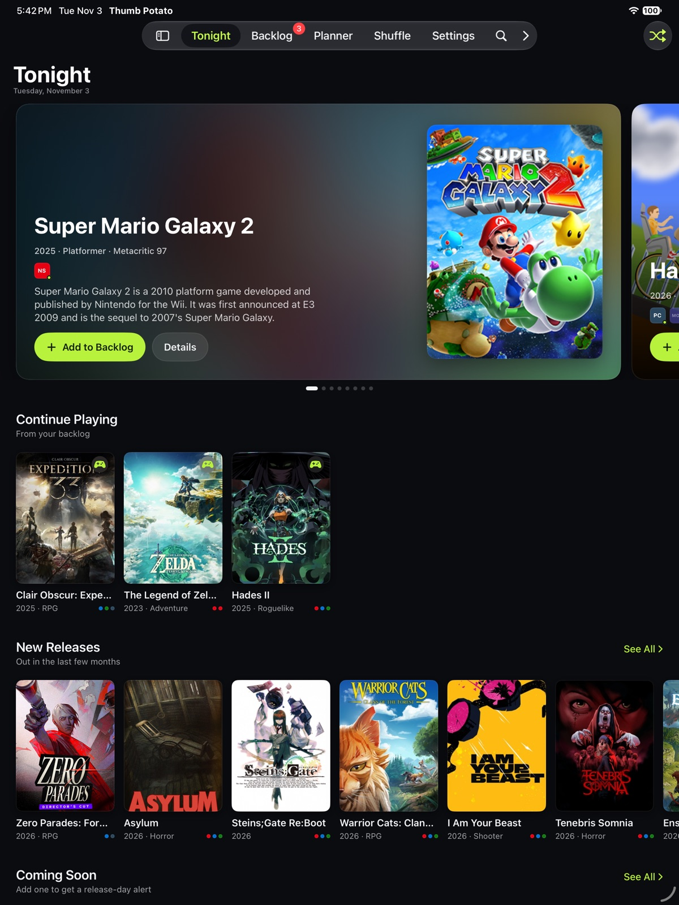
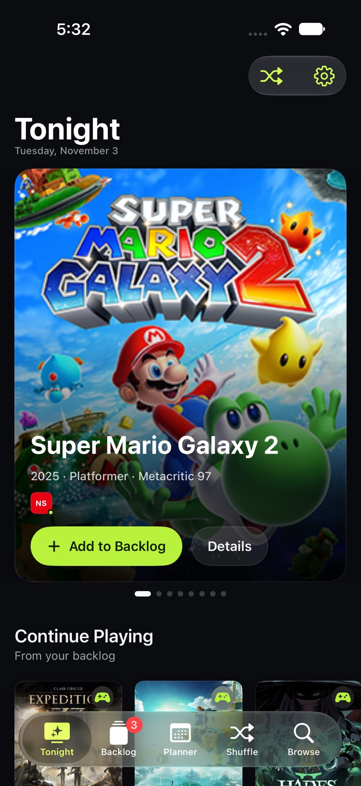
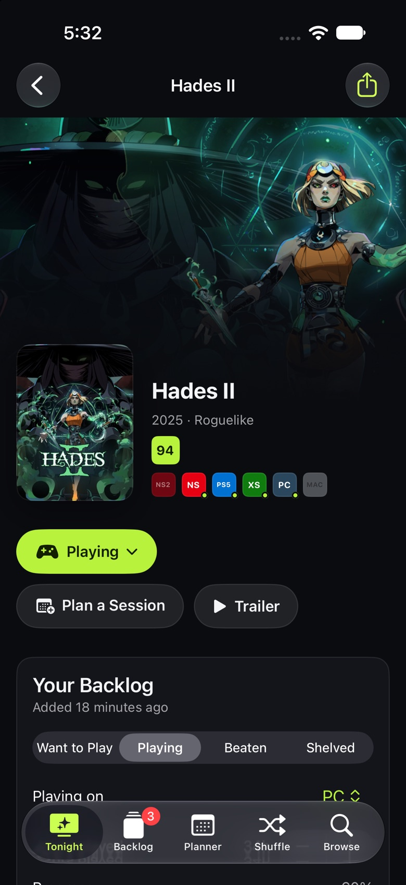
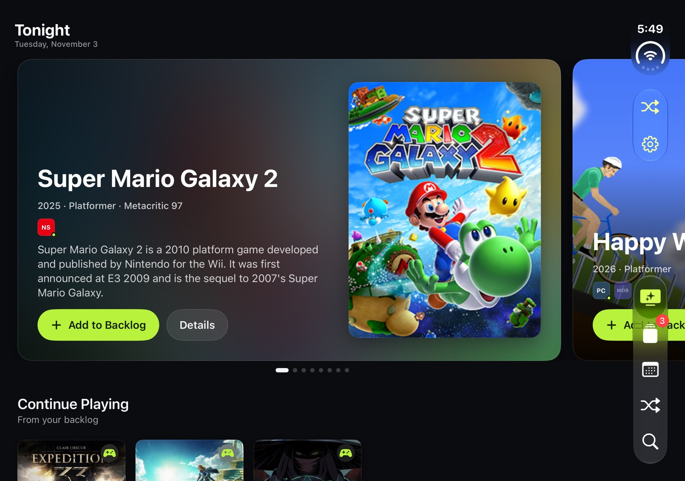
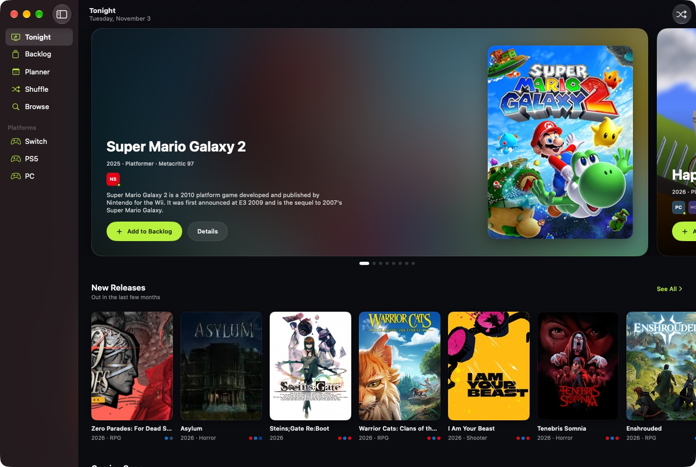
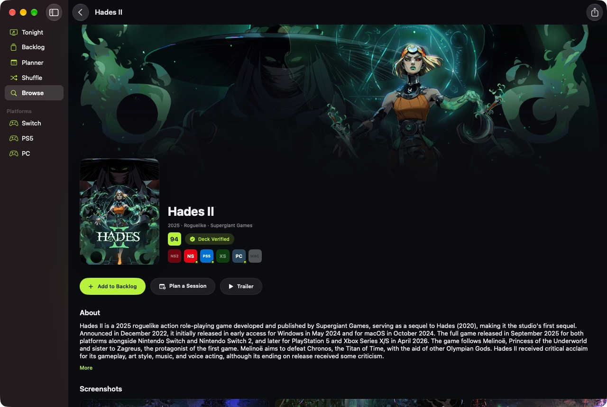
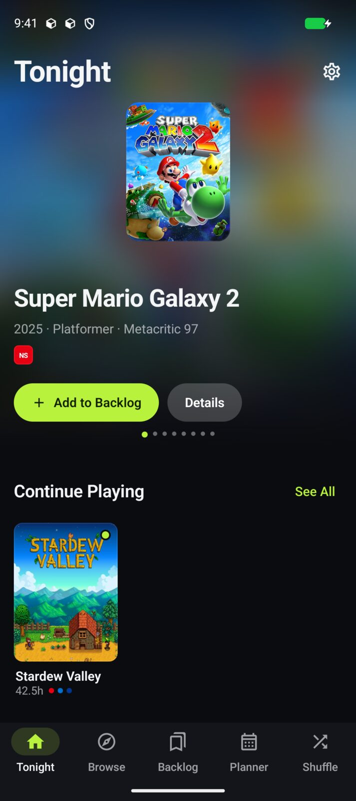
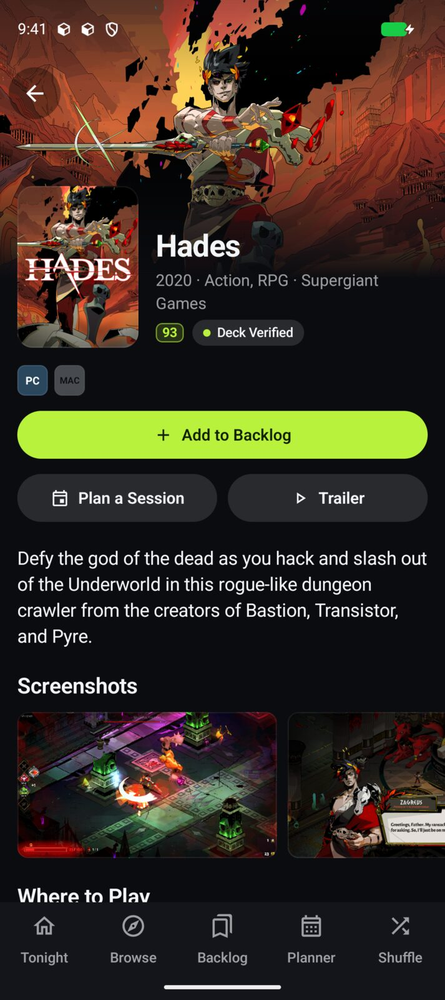

<p align="center"></p>

<h1 align="center">Thumb Potato</h1>

<p align="center"><b>Everything you want to play. One place.</b><br>
A "play later" companion for iPhone, iPad, iPhone Duo, Mac and Android. It finds games across Nintendo Switch 2, Switch, PlayStation 5 and 4, Xbox Series X|S and One, PC, Mac and mobile, shows where to buy them, keeps your backlog, tracks release dates, and helps you plan and pick what to play next.</p>

<p align="center"><a href="https://nearbycoder.github.io/thumb-potato/">Website</a> · <a href="#build">Build</a> · <a href="DESIGN.md">Design system</a> · <a href="SPEC.md">Spec</a> · <a href="https://nearbycoder.github.io/thumb-potato/privacy.html">Privacy</a></p>



## Features

- **Tonight** — a home feed with a featured carousel, Continue Playing, New Releases, Coming Soon, "Top on …" rows for the platforms you own, Steam top sellers and PC deals.
- **Backlog** — Want to Play, Playing, Beaten and Shelved, with the platform you're playing on, hours played, progress, "own it", 5-star ratings and notes. Filter by platform or genre; sort by date added, title, rating or release date.
- **Release Radar** — follow a game that isn't out yet and get a countdown and a release-day alert.
- **Planner** — schedule play sessions on a week view, add them to your calendar and get reminders.
- **Shuffle** — can't decide? Filter by mood, session length and platform, and let the deck pick from your backlog or from what's popular.
- **Moods** — Cozy, Adrenaline, Epic, Couch Co-op, Spooky, Brainy.
- **Where to Play** — store links for every platform a game is on (yours first), plus live PC prices across Steam, GOG, Humble, Epic and more.
- **Browse and filter** — every platform page sorts by popularity, newest, top rated or A–Z and filters by release window (including upcoming), genre and critic score.
- **Sync** — on Apple devices the backlog and sessions sync through iCloud (SwiftData + CloudKit) and settings through iCloud key-value storage; Handoff carries the game you're viewing between devices. Android stores everything on-device and exports/imports the same JSON backup.

| iPhone | Game detail (iPhone) | iPhone Duo |
|---|---|---|
|  |  |  |

| Mac | Game detail (Mac) |
|---|---|
|  |  |

| Android | Game detail (Android) |
|---|---|
|  |  |

## Data sources

Thumb Potato works out of the box with **no API key**:

- **Game catalog** — about 4,700 games across nine platforms, built weekly by [`scripts/build_catalog.py`](scripts/build_catalog.py) (a GitHub Action) from **[Wikidata](https://www.wikidata.org)** (CC0: platforms, release dates, genres, studios, critic scores), **[Wikipedia](https://en.wikipedia.org)** (box art and descriptions; text CC BY-SA) and **Steam** (library art, hero backdrops, Steam Deck ratings). It's published at [`/catalog/v1/`](https://nearbycoder.github.io/thumb-potato/catalog/v1/index.json) on the website.
- **Wikipedia** — full descriptions and search across every game with an article.
- **Steam** — top sellers, new releases, screenshots, trailers, reviews and prices for PC and Mac games.
- **[CheapShark](https://www.cheapshark.com)** — PC prices and deals across stores.

Add a free **[RAWG](https://rawg.io/apidocs) key** for live search and browsing across RAWG's full database. Paste it in **Settings → Data Sources** (on Apple devices it syncs through iCloud) or, for the Apple build, copy `Config/Secrets.example.xcconfig` to `Config/Secrets.xcconfig` and set `RAWG_API_KEY` (that file is gitignored).

> Thumb Potato isn't affiliated with Nintendo, Sony, Microsoft, Valve or any store; platform and store names appear as text and monograms, not logos.

## Build

### Apple (iPhone, iPad, iPhone Duo, Mac)

Requirements: Xcode 26 or later (built with Xcode 27.1), iOS/iPadOS 26+, macOS 26+, and [XcodeGen](https://github.com/yonaskolb/XcodeGen).

```sh
brew install xcodegen
git clone https://github.com/nearbycoder/thumb-potato
cd thumb-potato
xcodegen
open ThumbPotato.xcodeproj
```

It's one multiplatform target: pick the **ThumbPotato** scheme and run on an iPhone, iPad, iPhone Duo or "My Mac". iPad and Mac get a sidebar; phones get a tab bar, and the iPhone Duo uses its side-mounted tab bar in both poses.

**iCloud sync** needs a signed build with the `iCloud.com.nearbycoder.thumbpotato` CloudKit container. Set your own team in `project.yml` (`DEVELOPMENT_TEAM`), and change the bundle ID and container if you fork. Unsigned or simulator builds fall back to a local store automatically.

Tests:

```sh
xcodebuild test -project ThumbPotato.xcodeproj -scheme ThumbPotato \
  -destination 'platform=iOS Simulator,name=iPhone 18 Pro' CODE_SIGNING_ALLOWED=NO
```

### Android

Requirements: Android Studio (Ladybug or later) or a JDK 17+, Android SDK 37.

```sh
cd thumb-potato/android
./gradlew :app:installDebug      # or open the android/ folder in Android Studio
./gradlew :app:testDebugUnitTest
```

Kotlin + Jetpack Compose + Material 3, Room, DataStore, OkHttp, Coil. Phones get a bottom bar; wide and unfolded layouts get a navigation rail.

### Catalog

```sh
python3 scripts/build_catalog.py   # stdlib only, ~5 minutes; writes docs/catalog/v1/
```

### Deep links

Both apps open `thumbpotato://game/<key>` (for example `thumbpotato://game/wd-Q64577191` or `thumbpotato://game/steam-1145360`), plus `thumbpotato://platform/<id>`, `thumbpotato://shuffle`, `thumbpotato://planner` and `thumbpotato://backlog`.

## Project layout

```
ThumbPotato/       SwiftUI app (App, Models, Services, Views)
ThumbPotatoTests/  unit tests
android/           Kotlin / Compose app (single :app module)
scripts/           catalog builder
design/            app icon source (SVG)
docs/              GitHub Pages site and the published catalog
DESIGN.md          the shared design system
SPEC.md            the shared product and data spec
```

Thumb Potato is the gaming sibling of [Couch Potato](https://github.com/nearbycoder/couch-potato).

MIT License.
